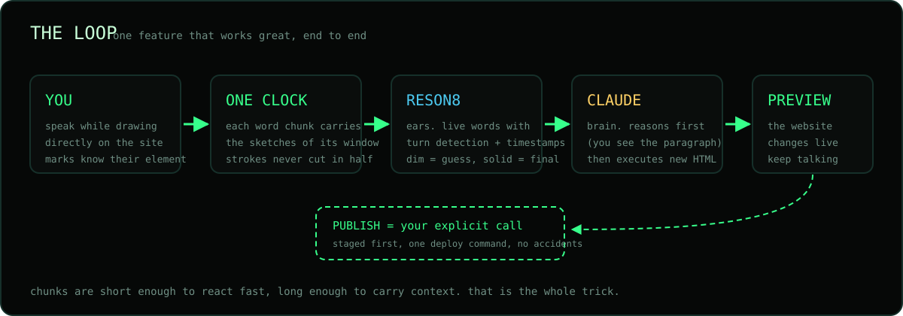
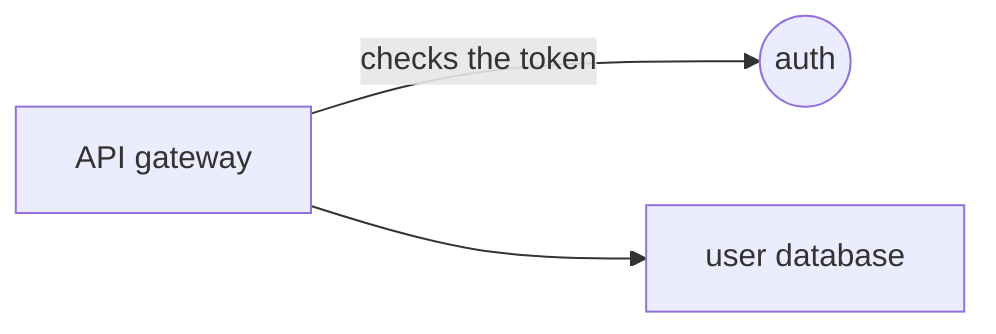

<p align="center">
  
</p>

<h1 align="center">calliope</h1>

<p align="center">
  <b>Speak to the agent while drawing on a website. It changes the website live.</b>
</p>

<p align="center">
  
  
  
  
  
</p>

In meetings people talk and sketch at the same time. Text alone loses the sketch. This agent takes both, your words and the marks you draw on the page, tied to the same clock, and rebuilds the website while the conversation keeps going.

Built at the Jamie Agentic AI Hack in Berlin, 24 October 2026.

## Team

| | |
|---|---|
| Jure Cerkez | M.Sc. Technology & Management, Fall 2025 |
| Ahmed Sohail | M.Sc. Technology & Management (Apollo11), Fall 2025 |
| Gonçalo de Deus | M.Sc. Technology & Management, Fall 2025 |
| Pascal Finn Krebs | M.Sc. Technology & Management, #district13 |
| Simon van Laak | PM Gen5, Co-Founder @ apparent |

## What it does

1. **You draw on the website itself.** No separate whiteboard. Visible pen marks land on the preview; each completed stroke keeps its full path, UTC point times, DOM context, and a tentative shape label. Closed marks also get a best-effort element at their centre.
2. **You speak while drawing.** Your microphone streams to Reson8. Dim lines are the live guess, solid lines are the committed sentence, all timestamped on the same clock as your marks.
3. **The agent changes the preview in Live mode.** Each committed spoken turn sends its marks to the agent; APPLY also sends marks without speech. It returns updated HTML; no written reasoning is required. Recording mode saves the same voice-and-mark timeline without calling the agent.

<p align="center">
  
</p>

## Blank canvas mode

Not every idea starts from a page. Choose **START BLANK CANVAS** on the opening screen to explain a flow, a draft, or a system design on an empty board while you talk. You can switch modes in the header afterward.

- **Recognized shapes become nodes.** Boxes, circles and triangles become nodes N1, N2, .... Unrecognized loops stay annotations rather than becoming guessed nodes. The canvas and website use the same stroke-shape recognizer; they interpret the resulting marks differently.
- **Lines between shapes become edges.** A stroke that starts at one shape and ends at another becomes an edge E1, E2, ... in the direction you drew it. A small tick at its end is read as the arrowhead.
- **Your words name things.** Point while you speak: "this is the API gateway", "here we have the user database", "call this the cache", "this sends the token". Each "this" or "here" binds to the mark drawn closest in time, using Reson8's word timestamps, and the name appears on the board.
- **COPY FOR AGENT** puts a Mermaid diagram, every spoken sentence with its timing and what it pointed at, and the full JSON on the clipboard. **COPY PNG** adds the drawing. Paste both into any agent (Claude, ChatGPT, Cursor, ...). Speech needs a Reson8 key and network connection.



The canvas code is `src/board.js` (drawing surface and PNG) and `src/diagram.js` (nodes, edges, names, Mermaid). Time matching lives in `src/lib/fusion.js`.

## Website operation modes

- **RECORDING** keeps voice and marks on one clock without changing the page or calling the agent. **COPY ARTIFACT** exports a Markdown transcript and JSON with marks and paths.
- **LIVE** sends each completed spoken turn and its marks to the agent automatically, which changes the preview. Marks alone wait for speech; contextual actions can send sketches or speech alone and retry a failed agent call. Switching modes keeps the two timelines separate.

Website URL fields are for importing a page, not typing instructions. Voice and drawing are the only instruction inputs.

## Why this shape

- **Chunks are the trick.** Short enough to react during a meeting, long enough to carry context. Each transcript chunk travels with the sketches made in its window. A stroke that crosses a boundary is sent whole, never cut in half.
- **Words and marks are compared.** When you say "make it bigger" and circle a box, the agent gets both. It must resolve conflicts between words and marks before editing, but need not explain its decision.
- **Nothing goes live from a meeting.** APPLY updates the preview; the studio has no publish control. A human decides when an idea is ready to leave the room.

## How it was built

The story of the build, in order, because the path is part of the answer.

1. **Research before code.** The morning went to the sponsors' actual APIs: Jamie's meeting data (REST, MCP, webhooks), Reson8's turns endpoint with word-level timestamps, and the Claude API. We picked meeting intelligence as the space because talk and sketch happen together there and every tool captures only one channel.

2. **We explored a character first.** The first concept was AGENT-741, a meeting referee that scores your promises: comedy cards on the surface, an eternal promise ledger underneath. We built a full visual shell for it. It taught us demo craft, and it exposed the real gap: notes without follow-through.

3. **The rules sharpened the target.** The competition brief said judged on technical complexity and creativity, bonus for partner tech, and the 19:00 "opt-in" was actually a submission: a 2-minute video, a detailed explanation, and a public repository with full API documentation.

4. **The pivot.** A teammate's board said it plainly: speak to the agent while drawing on the website. We cut the riskiest part (auto-deploy) and kept the novel part: words and marks on one clock, with the preview as the website and deployment as an explicit human decision.

5. **The spec became the contract.** Transcribe in short, timestamped chunks. Draw on the live website while capturing the HTML elements beneath the marks. Send each chunk with the sketches of its own time window, and never cut a stroke in half. Show the preview fast. Never publish an unfinished idea.

6. **The clock problem.** Message arrival time is not speech time. We found and reproduced a real bug where marks attached to the previous sentence, then placed every utterance at its true audio position using Reson8's per-word timestamps. Everything downstream compares on that clock.

7. **Fusion: words to marks.** "This", "that" and "here" bind to the mark nearest in time (6 seconds before, 2.5 seconds after, because people point slightly before speaking). "Move this here" resolves to two marks. Intent rules separate the subtle cases: "put the headline here" is a move, "put the new chart here" is an add.

8. **The agent executes.** The agent compares words with marks, then uses Pi's edit tool to change exact spans of a virtual HTML document; it does not need to return the full page. The prompt carries a structured timeline with intents, sketch geometry, DOM targets and explicit REFERENCE lines the agent is told to trust. Every mark is registered with the backend and gets a receipt before the agent accepts it.

9. **Prove it by running it.** The repository ships a runnable end-to-end script: generated speech to Reson8 to stroke receipt to agent response to executed HTML. Running it against the real APIs caught that Reson8's turn_end event is an empty marker and the text lives on turn_end_candidate. Real pipelines find real bugs.

10. **One studio, one team.** The web studio moved to Svelte and grew shape recognition (circles, squares, triangles, line direction and angle), multi-stroke marks and an import-any-URL canvas. An early Chrome extension experiment was removed cleanly, with its shared library (deictic fusion, Reson8 message adapter) kept in the studio. Every change shipped as a reviewed pull request.

11. **The loading screen is real 3D.** Four chrome-glass sponsor logos modeled in Blender (Jamie, Reson8, {Tech: Europe}, Anthropic), exported as glTF, spinning on dark glass tiles. A progress bar that slid backwards was fixed by giving it one monotonic source of truth, and the final invisible-logos bug turned out to be a broken relative import in a vendored loader that silently fell back to plain tiles: proven fixed by executing the module graph.

12. **Where it landed.** A runnable speech-to-agent proof against real APIs, 57+ automated tests, and a documented public repository. The browser's Live voice-to-preview path still needs an end-to-end check before we call that demo verified.

## Sponsor tech, and why

| Part | Technology | Why |
|---|---|---|
| Ears | **Reson8** speech to text, turns endpoint (API client: `calliope`) | Server side turn detection with timestamps, fast enough to react mid-meeting. Audio goes 16 kHz mono PCM through a small local relay so the API key never reaches the browser. |
| Brain | **Claude API (Anthropic)**, Haiku for speed | Uses spoken intent, drawing geometry, and target elements to call Pi's exact edit tool; the server returns validated HTML. |

## Run it

Requirements: Python 3.11 or newer, [uv](https://docs.astral.sh/uv/), Node.js with npm, and Chrome. The microphone needs a secure browser origin (localhost counts) and a reachable WebSocket audio relay.

```bash
cp .env.example .env   # fill in RESON8_API_KEY and ANTHROPIC_API_KEY
npm ci
npm run build
uv run server.py
```

With `AGENT_PROVIDER=auto` (the default), Calliope uses Anthropic (Claude). To use OpenRouter, set `AGENT_PROVIDER=openrouter` and `OPENROUTER_API_KEY` in `.env`, then restart the server. This pins `openai/gpt-oss-120b` to Cerebras only, with low reasoning effort; it does not fall back to another OpenRouter host or another key. `MODEL` sets the Claude model. Never commit `.env`. Then open **http://127.0.0.1:8800** in Chrome. Choose **IMPORT WEBSITE** with a public URL (or leave it empty to import **https://www.meetjamie.ai/**) or **START BLANK CANVAS**; no page loads automatically. On a website, choose Recording or Live, press **MIC ON**, and talk while drawing. Live applies completed speech turns automatically; contextual actions send sketches or speech alone and retry agent calls. Without the selected agent key, drawing works but agent calls report unavailable. Live marks are sent to the backend; failed deliveries can be retried, and an apply refuses unaccepted marks. `npm test` and `uv run --with websockets python -m unittest test/test_studio.py` run the local checks.

### Session diagnostic trace

The studio displays a **TRACE ID** for each browser session. The server writes an append-only JSONL file at `traces/<TRACE ID>.jsonl` by default. Set `CALLIOPE_TRACE_DIR` to an absolute, persistent directory outside a replaceable deployment release. The directory is owner-only (`0700`); each file is owner-only (`0600`). Do not expose traces via HTTP or commit them. Give an operator the TRACE ID to locate the file on the server.

Each file is capped at 8 MB and the directory at 64 sessions. Archive or remove older files privately before the directory fills; a failed trace blocks new Live agent requests rather than silently sending an unlogged instruction. Reload the studio after fixing trace storage to start a new session.

Events record final and candidate transcripts, empty turns and microphone errors; captured and accepted marks, receipts and failed delivery; imported HTML, complete agent prompts and request IDs; raw provider replies, errors, apply results and preview outcomes. These contain private page and meeting content. Raw microphone audio and API credentials are not logged. An older browser session without a TRACE ID cannot be reconstructed retroactively.

To use a website as the studio canvas, paste its public URL on the opening screen and press **IMPORT WEBSITE**. You can import another URL later in website mode. The server fetches its HTML, strips scripts, and opens it in the existing sandboxed preview; a failed import keeps you on the opening screen or leaves the current preview alone. This supports server-rendered public pages up to 200 KB of HTML. Client-rendered apps need scripts and will not render, and imported pages may load styles, images, and fonts from their original HTTPS hosts. Voice, drawing, and APPLY remain the studio's controls.

To use another website as the studio canvas, paste its public URL in **Website URL** and press **IMPORT URL**. The server fetches its HTML, strips scripts, and opens it in the existing sandboxed preview; a failed import leaves the current preview alone. This supports server-rendered public pages up to 200 KB of HTML. Client-rendered apps need scripts and will not render, and imported pages may load styles, images, and fonts from their original HTTPS hosts. Voice, drawing, and APPLY remain the studio's controls.

> Open the app through the server URL. Opening `index.html` directly does not work: without the server there is no mic relay and no agent.

## Layout

| File | What it is |
|---|---|
| `server.py` | HTTP server, Reson8 audio relay, bounded agent-provider edit loops |
| `pi_edit_adapter.mjs` | Published Pi edit tool with in-memory operations for one virtual `index.html` |
| `src/`, `frontend/`, `vite.config.mjs` | Svelte/Vite studio, Bits UI controls, drawing overlay, shape recognition, timeline, audio lifecycle, loader, blank canvas (`board.js`, `diagram.js`) |
| `dist/` | Built studio served by Python; generated by `npm run build`, not checked in |
| `test/` | JavaScript and Python tests, plus the optional `e2e_voice_test.py` voice-to-agent proof and its stroke fixture |
| `assets/` | The visuals in this README |

## Status

**Targeted APPLY:** `server.py` selects Claude, or the provider named by `AGENT_PROVIDER`. All three paths advertise only the published `@earendil-works/pi-coding-agent` 1.4.0 `createEditTool`, via Pi's actual schema and an in-memory adapter for virtual `index.html`. The model treats page HTML as untrusted document data and sends small edit calls rather than the whole updated page. The adapter receives no API credentials or general filesystem tools; this is a restricted tool interface, not an OS sandbox. Python validates the complete result and returns `{reasoning, html, agent_message}` only after the edit loop finishes. Errors return no HTML, keeping the preview and pending turn available for retry.

The document limit is 200,000 UTF-8 bytes. Each turn allows at most three model responses, 4,096 output tokens per response, eight tool calls per round, and sixteen exact replacements per call. Duplicate/missing spans, wrong paths, collateral changes, partial documents, and unfinished responses fail closed. A final explanation is optional. Tests cover rollback and protocol failures. A larger imported-page probe changed HTML but not exactly as requested. Claude tool use and real voice-to-browser quality remain unverified against live APIs. `npm audit` reports a high and moderate finding through Pi's pinned `undici` dependency; this adapter does not use its HTTP client.

**Working locally:** Svelte studio with the branded loader, pen drawing, full-path backend receipts and readback, tentative rough circle/square/triangle hints, time-aligned speech/sketch chunks, and Anthropic Claude targeted APPLY support. Provider selection and response handling are covered by mocked HTTP tests; live Anthropic and OpenRouter requests have not been verified. Typed instructions changed the preview in the isolated test deployment; the current Live voice-to-APPLY flow has not been verified end to end. The retired Chrome extension and classic page are no longer part of the app.

**Not yet built:** identifying the individual printed word inside an element such as `h1` when circled. Current targeting reports the DOM element; word-range geometry needs its own implementation and browser checks. Shape fixtures are synthetic, so test real hand-drawn traces before treating a tentative label as reliable.

**Not built on purpose:** auto deploy of agent changes. The preview is the website. Going live is one explicit command (`vercel deploy staging --prod`) that a human runs when the idea is ready.

## Demo

Two minute video from the hackathon: [link to be added]

## License

[MIT](LICENSE)
