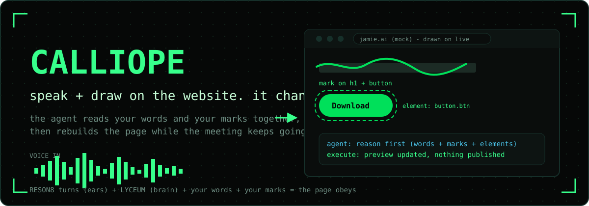

<p align="center">
  
</p>

<h1 align="center">calliope</h1>

<p align="center">
  <b>Speak to the agent while drawing on a website. It changes the website live.</b>
</p>

<p align="center">
  
  
  
  
  
</p>

In meetings people talk and sketch at the same time. Text alone loses the sketch. This agent takes both, your words and the marks you draw on the page, tied to the same clock, and rebuilds the website while the conversation keeps going.

Built at the Jamie Agentic AI Hack in Berlin, 24 October 2026. Team: Jure Cerkez, Simon van Laak.

## What it does

1. **You draw on the website itself.** No separate whiteboard. Marks land on the live page, and the app records which HTML element sits beneath every stroke. The element you chose gets a dashed anchor outline that scrolls with the page.
2. **You speak while drawing.** Your microphone streams to Reson8. Dim lines are the live guess, solid lines are the committed sentence, all timestamped on the same clock as your marks.
3. **The agent reasons, then executes.** On APPLY it reads the transcript chunks together with the sketches from the same time window and the elements under the marks. It writes one short paragraph of reasoning (you see it in the UI), then returns the updated HTML. The preview changes in place.

<p align="center">
  
</p>

## Why this shape

- **Chunks are the trick.** Short enough to react during a meeting, long enough to carry context. Each transcript chunk travels with the sketches made in its window. A stroke that crosses a boundary is sent whole, never cut in half.
- **Words and marks are compared.** When you say "make it bigger" and circle a box, the agent gets both. When your words and your marks disagree, the reasoning step says so out loud.
- **Nothing goes live from a meeting.** APPLY updates the preview. PUBLISH stages the page and prints the deploy command. A human decides when an idea is ready to leave the room.

## Sponsor tech, and why

| Part | Technology | Why |
|---|---|---|
| Ears | **Reson8** speech to text, turns endpoint (API client: `calliope`) | Server side turn detection with timestamps, fast enough to react mid-meeting. Audio goes 16 kHz mono PCM through a small local relay so the API key never reaches the browser. |
| Brain | **Anthropic Claude** | One call understands spoken intent plus drawing geometry plus the target elements, reasons about it in words, and writes the new HTML. |

## Run it

Requirements: Python 3.11 or newer, [uv](https://docs.astral.sh/uv/), a microphone, Chrome.

```bash
cp .env.example .env   # fill in RESON8_API_KEY and ANTHROPIC_API_KEY
uv run server.py
```

Then open **http://127.0.0.1:8800** in Chrome, press **MIC ON**, talk while drawing on the website, press **APPLY**.

> Open the app through the server URL. Opening `index.html` directly does not work: without the server there is no mic relay and no agent.

## Layout

| File | What it is |
|---|---|
| `server.py` | HTTP server, Reson8 audio relay, the reasoning and execution loop, staged publish |
| `index.html` | The app: drawing overlay injected into the website preview, element capture, shared timeline, equalizer, agent reasoning feed |
| `jamie-mock.html` | A mock of the jamie.ai homepage with their real copy. This is the canvas in the demo |
| `e2e_voice_test.py` | Proof of the voice to agent path. Generates speech, runs it through Reson8, feeds the real transcript to the agent, prints the reasoning and the executed HTML |
| `assets/` | The visuals in this README |

## Status

**Working:** live voice transcript with interim and final turns, drawing on the website with element capture and anchored outlines, time aligned chunks of speech and sketches, Claude reasoning plus execution, staged publish.

**Not built on purpose:** auto deploy of agent changes. The preview is the website. Going live is one explicit command (`vercel deploy staging --prod`) that a human runs when the idea is ready.

## Demo

Two minute video from the hackathon: [link to be added]

## License

[MIT](LICENSE)
