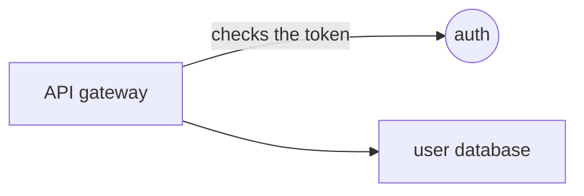

<p align="center">
  
</p>

<p align="center">
  
</p>

<h1 align="center">calliope</h1>

<p align="center">
  <b>Speak to the agent while drawing on a website. It changes the website live.</b>
</p>

<p align="center">
  
  
  
  
  
</p>

In meetings people talk and sketch at the same time. Text alone loses the sketch. This agent takes both, your words and the marks you draw on the page, tied to the same clock, and rebuilds the website while the conversation keeps going.

Built at the Jamie Agentic AI Hack in Berlin, 24 October 2026.

## Team

| | |
|---|---|
| **Jure Cerkez** | M.Sc. Technology & Management, Fall 2025 |
| Ahmed Sohail | M.Sc. Technology & Management (Apollo11), Fall 2025 |
| Gonçalo de Deus | M.Sc. Technology & Management, Fall 2025 |
| Pascal Finn Krebs | M.Sc. Technology & Management, #district13 |
| Simon van Laak | PM Gen5, Co-Founder @ apparent |

## What it does

1. **You draw on the website itself.** No separate whiteboard. Visible pen/highlighter marks land on the preview; each completed stroke keeps its full path, UTC point times, DOM context, and a tentative shape label. Closed marks also get a best-effort element at their centre.
2. **You speak while drawing.** Your microphone streams to Reson8. Dim lines are the live guess, solid lines are the committed sentence, all timestamped on the same clock as your marks.
3. **The agent reasons, then executes.** On APPLY it reads transcript chunks with accepted strokes from the same time window. Recognized shapes lead with readable time, bounds, and target hints; unknown marks retain the raw SVG path. It writes one short paragraph of reasoning, then returns updated HTML for the preview.

<p align="center">
  
</p>

## Blank canvas mode

Not every idea starts from a page. Choose **START BLANK CANVAS** on the opening screen to explain a flow, a draft, or a system design on an empty board while you talk. You can switch modes in the header afterward.

- **Shapes become nodes.** Boxes, circles and triangles (and any closed loop) become nodes N1, N2, ....
- **Lines between shapes become edges.** A stroke that starts at one shape and ends at another becomes an edge E1, E2, ... in the direction you drew it. A small tick at its end is read as the arrowhead.
- **Your words name things.** Point while you speak: "this is the API gateway", "here we have the user database", "call this the cache", "this sends the token". Each "this" or "here" binds to the mark drawn closest in time, using Reson8's word timestamps, and the name appears on the board.
- **COPY FOR AGENT** puts a Mermaid diagram, every sentence with its timing and what it pointed at, and the full JSON on the clipboard. **COPY PNG** adds the drawing. Paste both into any agent (Claude, ChatGPT, Cursor, ...). No API key is needed for this mode, and typed sentences (SAY) work without a microphone.



The canvas code is `src/board.js` (drawing surface and PNG) and `src/diagram.js` (nodes, edges, names, Mermaid). Time matching lives in `src/lib/fusion.js`.

## Why this shape

- **Chunks are the trick.** Short enough to react during a meeting, long enough to carry context. Each transcript chunk travels with the sketches made in its window. A stroke that crosses a boundary is sent whole, never cut in half.
- **Words and marks are compared.** When you say "make it bigger" and circle a box, the agent gets both. When your words and your marks disagree, the reasoning step says so out loud.
- **Nothing goes live from a meeting.** APPLY updates the preview. PUBLISH stages the page and prints the deploy command. A human decides when an idea is ready to leave the room.

## Sponsor tech, and why

| Part | Technology | Why |
|---|---|---|
| Ears | **Reson8** speech to text, turns endpoint (API client: `calliope`) | Server side turn detection with timestamps, fast enough to react mid-meeting. Audio goes 16 kHz mono PCM through a small local relay so the API key never reaches the browser. |
| Brain | **Anthropic Claude** | One call understands spoken intent plus drawing geometry plus the target elements, reasons about it in words, and writes the new HTML. |

## Run it

Requirements: Python 3.11 or newer, [uv](https://docs.astral.sh/uv/), Node.js with npm, and Chrome. The microphone needs a secure browser origin (localhost counts) and a reachable WebSocket audio relay.

```bash
cp .env.example .env   # fill in RESON8_API_KEY and ANTHROPIC_API_KEY
npm ci
npm run build
uv run server.py
```

Then open **http://127.0.0.1:8800** in Chrome. Choose **IMPORT WEBSITE** with a public URL or **START BLANK CANVAS**; no demo page loads automatically. On a website, press **MIC ON**, talk while drawing, then press **APPLY**. Without an Anthropic key, drawing works but APPLY reports that the agent is unavailable. The browser sends each completed stroke to the backend; failed deliveries can be retried, and APPLY refuses unaccepted strokes. `npm test` and `uv run --with websockets python -m unittest test_studio.py` run the local checks.

To use a website as the studio canvas, paste its public URL on the opening screen and press **IMPORT WEBSITE**. You can import another URL later in website mode. The server fetches its HTML, strips scripts, and opens it in the existing sandboxed preview; a failed import keeps you on the opening screen or leaves the current preview alone. This supports server-rendered public pages up to 200 KB of HTML. Client-rendered apps need scripts and will not render, and imported pages may load styles, images, and fonts from their original HTTPS hosts. Voice, drawing, APPLY, and staged PUBLISH remain the studio's existing controls.

To use another website as the studio canvas, paste its public URL in **Website URL** and press **IMPORT URL**. The server fetches its HTML, strips scripts, and opens it in the existing sandboxed preview; a failed import leaves the current preview alone. This supports server-rendered public pages up to 200 KB of HTML. Client-rendered apps need scripts and will not render, and imported pages may load styles, images, and fonts from their original HTTPS hosts. Voice, drawing, APPLY, and staged PUBLISH remain the studio's existing controls.

> Open the app through the server URL. Opening `index.html` directly does not work: without the server there is no mic relay and no agent.

## Layout

| File | What it is |
|---|---|
| `server.py` | HTTP server, Reson8 audio relay, the reasoning and execution loop, staged publish |
| `src/`, `frontend/`, `vite.config.mjs` | Svelte/Vite studio, Bits UI controls, drawing overlay, shape recognition, timeline, audio lifecycle, loader, blank canvas (`board.js`, `diagram.js`) |
| `dist/` | Built studio served by Python; generated by `npm run build`, not checked in |
| `jamie-mock.html` | A mock of the jamie.ai homepage for optional local demos; it is not loaded on startup |
| `e2e_voice_test.py` | Proof of the voice to agent path. Generates speech, runs it through Reson8, feeds the real transcript to the agent, prints the reasoning and the executed HTML |
| `assets/` | The visuals in this README |

## Status

**Working locally:** Svelte studio with the branded loader, pen/highlighter drawing, full-path backend receipts and readback, tentative rough circle/square/triangle hints, time-aligned speech/sketch chunks, Claude reasoning plus preview execution when keyed, and staged publish. The Chrome extension is a separate surface merged through PR #1; this studio change does not replace it.

**Not yet built:** identifying the individual printed word inside an element such as `h1` when circled. Current targeting reports the DOM element; word-range geometry needs its own implementation and browser checks. Shape fixtures are synthetic, so test real hand-drawn traces before treating a tentative label as reliable.

**Not built on purpose:** auto deploy of agent changes. The preview is the website. Going live is one explicit command (`vercel deploy staging --prod`) that a human runs when the idea is ready.

## Demo

Two minute video from the hackathon: [link to be added]

## License

[MIT](LICENSE)
